<!-- Os SVGs de assets/ são gerados por tools/gerar.mjs (npm run assets) -->

  

Trabalho com **monitoramento de redes em provedor de internet**. Meu dia é olhar OLT, CTO, link e servidor,
e o que eu mais gosto é transformar esse mar de alertas num painel que qualquer pessoa do NOC entende de primeira.

Quando a ferramenta certa não existe, eu escrevo: painel de incidentes, central de comunicados, integrações
com o ERP, sites e um agente de IA que responde com base nos manuais da empresa.

- 📡 **No NOC:** Zabbix, Grafana, NetBox e LibreNMS, com painel rodando até na TV da sala
- 🧩 **Integrações:** ERP IXC, Supabase e APIs que precisam conversar entre si
- 🤖 **IA com pé no chão:** RAG rodando local no LM Studio, com temperatura 0 para não inventar resposta
- 🌐 **Web:** sites e painéis em JavaScript, TypeScript, React e Next.js
- ✨ **Detalhe que importa:** animação, 3D com Three.js e interface que dá vontade de usar

 

  
  

  
  

🔒 A Central NOC, a Central de Comunicados e o Agente de IA são ferramentas internas, por isso o código é privado. Mostro funcionando numa conversa.

 

  

<picture>
  <source media="(prefers-color-scheme: dark)" srcset="https://raw.githubusercontent.com/cristianprevot05-web/cristianprevot05-web/output/snake-dark.svg" />
  
</picture>

  

<i>"Alerta bom é o que chega antes da ligação do cliente."</i>

