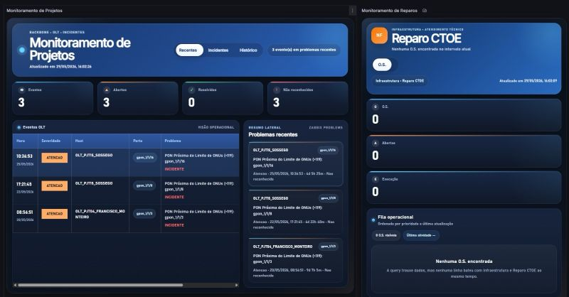
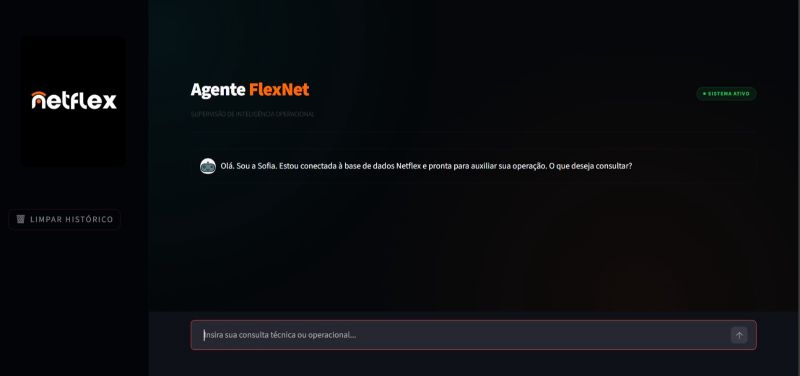

<!-- Os SVGs de assets/ são gerados por tools/gerar.mjs (npm run assets) -->

Trabalho com **monitoramento de redes num provedor de internet**. Passo o dia de olho em OLT, CTO, link e servidor,
e gosto de transformar esse mar de alertas num painel que qualquer pessoa do NOC entende de primeira.

Quando a ferramenta certa não existe, eu escrevo. Três delas estão abertas aqui embaixo.
No site, o globo do topo gira com o mouse: **[cristianprevot05-web.github.io](https://cristianprevot05-web.github.io)**

## Central de Comunicados

Monta o aviso de rompimento, instabilidade ou manutenção no modelo oficial, passa por aprovação e publica
no Instagram do provedor, na hora ou agendado. Quando a rede volta, um botão monta o “Normalizado” com as mesmas regiões.

[Ler o código](https://github.com/cristianprevot05-web/central-de-comunicados)

O que mais ela faz

 

- Story com link: na hora marcada chega um aviso no celular, com o link já copiado para a figurinha.
- Cada pessoa tem o próprio login, e o administrador escolhe quais ferramentas cada uma usa.
- Toda ação fica num registro com nome, hora, aparelho e IP que ninguém apaga, nem o administrador.
- Roda nos planos gratuitos do Supabase, com a API em PHP na hospedagem.

## Monitoramento de Redes

Dois painéis no Grafana. O da esquerda junta os eventos das OLTs que chegam do Zabbix e separa o que ainda
não foi reconhecido. O da direita puxa do IXC as ordens de serviço de reparo de CTO e avisa quando a mesma caixa ganha uma OS duplicada.

[Ler o código](https://github.com/cristianprevot05-web/Monitoramento-de-Redes)

## Sofia, agente de IA do suporte

Faz a triagem das ordens de serviço do IXC e acha a resposta nos manuais da empresa. Roda local no LM Studio
com temperatura 0, e as senhas de equipamento vêm de uma tabela fixa, para o modelo nunca inventar uma.

[Ler o código](https://github.com/cristianprevot05-web/agente-de-ia)

## Ferramentas

## Atividade

<picture>
  <source media="(prefers-color-scheme: dark)" srcset="https://raw.githubusercontent.com/cristianprevot05-web/cristianprevot05-web/output/snake-dark.svg" />
  
</picture>
